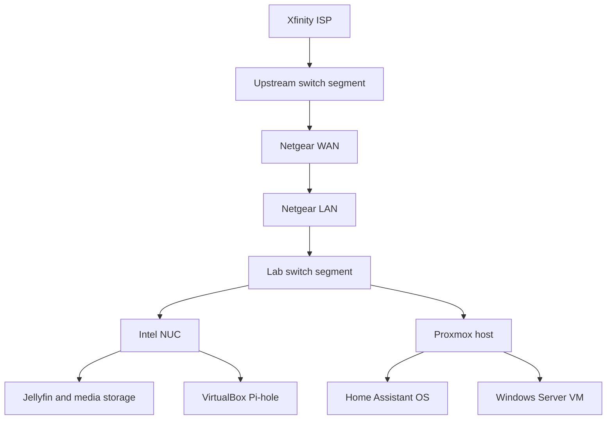

# Architecture

The lab separates a service host from a virtualization host. This lets desktop-hosted services and experimental VMs coexist without moving every workload at once.

| Component | Documented role |
| --- | --- |
| Xfinity ISP gateway | Upstream connectivity |
| Netgear R6230 | Lab router between upstream and lab segments |
| Cisco Catalyst 2960-X | Layer-2 switching and VLAN separation |
| Intel NUC / Windows 11 | Jellyfin, Cloudflare connector, VirtualBox Pi-hole |
| Dell OptiPlex / Proxmox | Home Assistant OS and Windows Server VMs |
| External USB storage | Media storage attached to the NUC |
| Windows desktop and Mac | Administration and tool access |

## Logical layout

The upstream and lab switch segments share a physical Catalyst chassis. They are separate Layer-2 segments, not a single unsegmented link between the router's WAN and LAN. The diagram describes dependencies and roles; it intentionally omits port numbers and real addresses.

## Dependency lessons

Rebooting the NUC can affect both media access and DNS. Rebooting Proxmox affects its guest services. A Cloudflare endpoint can fail while the local media service remains healthy, so local and external availability should be observed separately. USB capacity alone does not establish redundancy or backup coverage.
